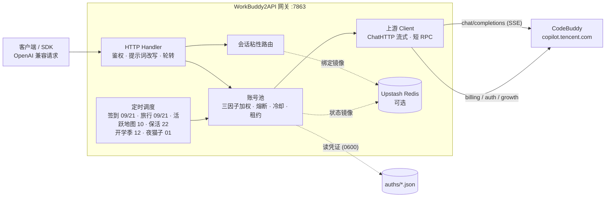

> [!WARNING]
>
> ### 禁止商用倒卖
>
> **禁止将本项目的源代码（含其衍生版本、修改版本，以及任何实质性相同的副本）用于商业转售、倒卖或付费分发。**
>
> 具体包括但不限于：出售本项目源码或"源码授权"；以"付费进群 / 付费教程 / 加盟费 / 代理费 / 技术支持费"等任何名义把源码作为对价交付；把本项目打包后以"源码版"为卖点单独收费；
> 以及声称已获作者授权进行上述活动。
>
> **允许**：个人学习、研究、测试；自行部署使用（含为你自己或所在组织提供服务）；
> 非营利性的分享、fork 与二次开发。
>
> **法律边界的诚实说明（请勿误读）**：本项目采用 MIT License，该授权**不可撤销** ——
> 已获得副本的人本就拥有"使用、复制、修改、合并、发布、分发、再许可和/或销售"的权利，
> 本声明**无法收回**这些权利。因此它的准确定位是：**作者意愿的明确表达** +
> **"从未作出商业倒卖授权"的事实记录**，并在**商标与品牌层面**具备实际效力
> （MIT 不授予商标权，冒用作者身份或本项目名义的商业倒卖可被主张侵权）。
> 若需要让"禁止商用"具备完全的法律强制力，只能更换许可证（如 PolyForm Noncommercial），
> 且只能对**新发布的版本**生效。完整说明见 [NOTICE](NOTICE)。

<h1 align="center">WorkBuddy2API</h1>

<p align="center">
  
  <b>把 CodeBuddy 账号变成 OpenAI 兼容 API 的多账号网关</b>  

  
  OAuth 登录 · 账号池轮转 · 熔断与冷却 · 会话粘性 · 积分补充
  
</p>

<p align="center">
  
  
  
  
  
  
  
  
  
</p>

---

## 项目简介

WorkBuddy2API 是一个自托管的 **OpenAI 兼容上游网关**，将 `CodeBuddy` 账号包装为统一的 `/v1/chat/completions` 服务。

### 本项目做什么

- 通过 **OAuth 设备授权**（`login.sh`）获取账号凭证，在网关侧做 token 自动刷新、账号池调度与流量治理；
- 面向 **个人多账号** 场景：多账号共享、单号故障自动换号、冷却 / 熔断防止雪崩、会话粘性保证多轮上下文不跳号；
- 对客户端只暴露 OpenAI 兼容接口，现有 SDK / 前端 / 工具 **零改造接入**。

### 两个可执行产品（**请先确认你要跑哪个**）

本仓库同时维护两个入口，它们**互相独立、端口不同、配置方式不同**：

| 入口                 | 可执行                         | 默认端口     | 说明                                                                                                       |
| ------------------ | --------------------------- | -------- | -------------------------------------------------------------------------------------------------------- |
| **Web 应用中转站**（主产品） | `cmd/webapp` → `webapp.exe` | **8780** | 单进程 = 网站 + 用户控制台 + **内置管理后台** + OpenAI 兼容网关。账号/计费/兑换/提现/代挂都在 SQLite 里，全部界面化。启动脚本 `dist/start-webapp.bat`（随分发包提供） |
| 网关核心（精简版）          | `cmd/server` → `wb2api.exe` | 7863     | 只有 OpenAI 兼容网关 + 账号池，**无 Web 界面**；配置文件 `config.json` + 环境变量 `WB2A_*`                                     |

> **关于「不内嵌 Web 管理面板」**：那条描述只适用于**网关核心 `cmd/server`**。
> **Web 应用中转站 `cmd/webapp` 就是内置管理后台的**（admin.html / dashboard.html 由 exe 内嵌提供，
> 无需另装前端）。下面「快速开始」给的是网关核心的步骤；
> Web 中转站的使用说明随分发包提供（`dist/Web应用使用说明.md`）。

### 本项目不做什么

- **只做上游网关，不做下游协议转换** — 本项目仅负责对接上游 `CodeBuddy` 并暴露 OpenAI Chat 协议；Anthropic Messages、Gemini 等其他协议的适配应由下游网关负责。
- **网关核心（cmd/server）不内嵌 Web 管理面板** — 该入口保持精简；需要界面的用主产品 `cmd/webapp`。
    
  （想用第三方面板也可部署社区项目，均独立维护、与网关解耦：
    
  [workbuddy2api-gui](https://github.com/287775856/workbuddy2api-gui)、
    
  [workbuddy-manager](https://github.com/ithtelab/workbuddy-manager)）

> ⚠️ 合规须知：本项目是**非官方**网关，使用 `CodeBuddy` 账号作为上游，**仅限本人授权账号、本机 / 私有环境测试**。详细边界见[安全与合规](#安全与合规)。

📖 **关于文档**：本仓库**只放源码**。分发包内容（`dist/`，含 `Web应用使用说明.md` 与 `start-webapp.bat`）与内部调研/事件笔记（`docs/`）**刻意不随源码库外发** ——
前者含运行期密钥与二进制，后者含部署拓扑与账号处置记录。因此下文出现的 `dist/…` / `docs/…` 是**分发包内或本地笔记的路径**，在 GitHub 上点不开属正常。

## 核心能力

### 账号池治理

- **OAuth 设备授权登录** — `login.sh` 一条命令完成：取授权 URL → 浏览器登录 → token 轮询 → 凭证落盘 → 重启加载，全程无 PKCE（state 由服务端签发），重复执行即可连续添加多账号
- **三因子加权随机选号** — `credits 比例 ×10 + 快过期积分占比 ×8 + 闲置补偿` 三项加权（`pool.expiring_soon` 窗口内的积分优先消耗，默认 7 天），按权重降序取 **Top-5 候选短名单**，再在短名单内加权抽签（等权重候选先随机打乱防惊群、LRU 兜底覆盖全部候选），兼顾积分多、快过期积分先用掉、闲置久的账号；失败账号由熔断 / 冷却 / 连败降权状态机处置（不进权重公式）
- **防惊群** — 跳过 100ms 内刚被选中的账号，多账号同时待命时不打爆同一台
- **在途租约** — 单账号最大在途请求数（`pool.max_in_flight`）限制并发占用，占满的号不参与选号，避免单号过载
- **账本择优** — 每次成功请求按 `usage.credit` 折算每千 token 单价记入 `(账号, 模型)` 账本，免费 / 便宜的账号优先；观测按 EMA 平滑、6 小时未更新即失效（陈旧价格不复活），成本随上游活动实时变化；账本随池状态落盘 `state.json`，重启不丢学费；`/status` 透出 `model_costs` 台账（模型 / 单价 / 末次观测 / 样本数）
- **成本分层条件探索** — costTier 硬过滤（免费 > 未知 > 收费）会把全池锁死在唯一的实测免费号上：其余账号永远轮不到、也就永远学不到「它其实也免费」（垄断 + 学习冻结，issue #136）。破解方式是**搭车改道**：tier 0 垄断层存在且 tier 1 有成员时，距上次探索 ≥ `pool.cost_explore_interval`（默认 30m，`"0"` 关停）就把本次选号改道给一个未知号——承接的是完整真实用户请求，**零新增上游请求**（IP 维度零增量，WAF 友好）。成功即毕业（首观测入账，免费回 tier 0 / 收费出局 tier 2，学费只付一次）；失败走既有冷却 / 熔断策略，无探测风暴。探索频率硬性限幅 ≤ 48 次 / 天 / 模型（24h ÷ 30m），与池规模和 QPS 无关；tier 1 枯竭后自动停探。探索节奏按 `(域, 模型)` 独立；`/status` 透出 `cost_explore` 台账（累计事件数 + 各 (域, 模型) 最近探索时刻），与 `model_costs` 行对照即可读出「探索 → 毕业」全链路

### 流量治理

- **分级熔断与冷却** — 429 软冷却（600s 起指数退避、封顶 `soft_rate_max`）、404 固定浅冷却、402 / 余额耗尽硬冷却至次日 04:00、连续失败熔断（`breaker_threshold` 触发后指数退避封顶 6h）
- **模型级限流独立冷却** — 6004（该模型使用量超限）只冷却触发调用的模型，切其他模型立即可用；`/status` 透出 `rate_limited_models` 台账
- **当日积分预算闸**（`budget.daily_credit_limit`，缺省 `0` = 不限）— 给「跑飞的客户端 / 忘了关的脚本」装一道钱闸：当日累计扣费达到上限后，网关直接拒掉后续对话请求（`429` + `daily_budget_exceeded`，错误文案带上已用与上限），把积分损失截断在阈值附近。计数按 **CST 自然日**重置（与上游增长体系同口径），进程内不落盘、重启清零。只统计上游 `usage` 给出 `credit` 的请求（缺观测不计入，与成本账本同一纪律），所以当日用量是一个**下界**、真实日耗只会更多——阈值宜按保守值设；也可以先留 `0` 当观察模式跑几天，看 `/status` 里 `daily_budget.used` 的真实日耗再定值。闸在**读请求体之前**判定（被拒的请求不会被白读进内存），且**不改变选号**——它只决定「这一枪开不开」，不做「换便宜号」的降级。实时台账（当日已用 / 上限 / 当日被拒次数 / 归属日）在 `/status` 的 `daily_budget`
- **账号临时停用 / 恢复** — 运维可把某个号临时摘出选号池、观察后再放回，不必删凭证（issue #138/#118）。语义是「对话流量摘除」而非「账号冻结」：停用期间签到、token 保活、排程任务照常执行，账号仍在池里、状态照常透出。与系统自动禁用是**两个独立状态位**（`manual_disabled` / `disabled`），各自清除、都清空才回到选号池——避免运维意图被签到解冻等自动复活路径意外解除；停用状态随池状态落盘，重启保留。入口：`/admin/accounts/{uid}/{disable,enable,revive}` 端点 + `cmd/acct` CLI（默认关闭，`admin.enabled` 显式开启）
- **状态持久化** — 池状态（积分 / 冷却 / 熔断 / 计数）本地原子落盘 `state.json`，可选镜像至 Upstash Redis，重启后择优恢复

### 可观测与告警

- **Prometheus 指标端点**（`metrics.enabled`，缺省关闭）— 开启后暴露 `GET /metrics`（Prometheus 文本格式 0.0.4），一次抓取即可拿到账号池规模与各状态分布、在途请求数、会话粘性绑定数、成本探索累计触发次数、WAF IP 拦截是否生效，以及按模型的请求数（成功 / 失败）、流式请求数、token 与缓存 token（命中 / 未命中 / 写入）、积分消耗、首字节与端到端平均耗时、生成吞吐。池维度按 realm（`cn` / `global` / `all`）拆分，指标名与标签值固定顺序输出，逐次抓取结果稳定可比、对不上口径时能直接 diff。口径与 `/status` 同源（同一次聚合，不存在两套数），只暴露聚合量——不含账号 uid、token 等敏感维度；开启后仍受 `api_key` 鉴权保护，与 `/status` 同级。另有 `wb2api_task_*` 一族，输出每类定时任务的**最近一轮**（执行时间戳、各结果计数、是否全灭），只对跑过的任务输出序列
- **可用性阈值告警**（`alerting.enabled`，缺省关闭）— 开启后按 `alerting.interval_seconds`（默认 30s）周期评估池健康度，越界即向 `alerting.webhook_url` 投递 JSON；填 `alerting.secret` 则对请求体做 HMAC-SHA256 签名（`X-WB2A-Signature` 头），接收端可校验来源。三类规则：**健康账号数不足**（按域分别设阈值，`min_healthy_cn` 默认 1、`min_healthy_global` 默认 0 = 不评估该域，纯 CN 部署不会因国际版为空而常驻误报）、**熔断账号数超限**（`breaker_threshold`，默认 0 = 不评估）、**WAF IP 拦截生效**（旋转失败的快速失败信号）。触发是**边沿触发**：连续满足 `alerting.for_ticks` 拍才投递一次，持续越界期间不重复刷屏；恢复需连续满足 `alerting.clear_ticks` 拍才解除（迟滞防抖），解除后可再次触发，不会在临界点来回抖动。`alerting.startup_grace_seconds`（默认 30s）内不评估，避开启动初期账号尚未同步的空池假告警；`alerting.send_resolve` 可额外投递恢复通知。投递超时（`alerting.timeout_seconds`，默认 5s）不阻塞主流程，通知内容不含任何凭证
- **管理操作审计**（`admin.audit_enabled`，缺省关闭）— 开启后 `/admin` 下每个动作（账号停用 / 恢复 / 复活、手动补跑任务）都向 `admin.audit_file`（默认 `./data/admin_audit.log`）追加一行 JSONL，记下**何时、对谁、做了什么、结果如何、从哪来**：时间戳、动作名、对象（账号 uid 或任务名）、响应状态码、来源 IP、`api_key` 指纹，以及停用时填写的理由。用来回答「这个号是谁停的、什么时候停的、为什么」——池状态里的 `manual_reason` 只保留**最新**一条，改动历史只在这里。几处刻意取舍：**只记通过鉴权的请求**（匿名探测不落盘——否则任何人都能靠刷 `/admin` 写满运维的磁盘）；**`api_key` 只存不可反推的指纹、不存原文**；**每条记录独立开-写-关**，故外部 `logrotate` 轮转后进程会自动写新文件，不会继续写进已被移走的旧文件而静默丢失；**审计写失败只告警、不失败请求**（磁盘满时管理操作照常完成——操作结果本身已落在池状态里，而「审计写不进去就拒绝操作」会把一次磁盘故障升级成「坏账号摘不掉」）。路径不可写会在**启动时**直接报错退出，不拖到第一次管理操作才发现。需与 `admin.enabled` 同时开启（审计的对象就是这些端点）

### 请求链路

- **流式 + 非流式** — 出站强制 `stream:true`；SSE 帧按 OpenAI 规范白名单重建；非流式由本地聚合为单响应
- **DeepSeek 思维链注入** — 出站请求体注入 `thinking.type=enabled` + 默认档位，`reasoning_content` 多轮回填，`reasoning_effort` 按模型档位自动降级
- **系统提示词三模式**（`prompt.mode`，缺省 `passthrough`） —
  - `passthrough`（缺省）：透传客户端原始 system，遇内容拦截自动降级中性提示词重试
  - `custom`：网关用自有提示词**替换**客户端 system/developer（从源头消除模板句误报；不参与降级）
  - `append`：**两者并用**——开头连续 system/developer 块之后插入网关自有提示词，客户端项目规范/工具约定与网关人格共存（issue #129）；降级期与拦截首遇重试时退化为 `custom` 语义（换中性提示词，原文 system 移除）
  - `prompt.file`（custom/append 生效）指向自定义提示词文件，空 = 内置默认
- **会话头族注入** — 出站携带官方客户端会话头族（`X-Conversation-Request-ID` 聚合主键 · `X-Conversation-ID` 透传 · B3 链路），轮转 / 重试 / 路径回退复用同键，后台按对话轮聚合不再碎片化（issue #35）
- **指纹脱敏** — 出站请求体黑名单指纹字段清洗（可开关），与提示词体系两层叠加

### 选号语义

选号 = 会话粘性（命中即定）→ 成本分层（硬过滤）→ 加权随机（软均衡）三层串联，各层语义：

- **成本分层** — 账本把每个 `(账号, 模型)` 归入三档：**tier 0**（实测免费，单价 ≤ 0）、**tier 1**（无观测）、**tier 2**（实测收费）。同一次选号在**存活的最便宜档内**选：有 tier 0 就只在 tier 0 里挑，全池无免费观测才落到 tier 1，再不行才是 tier 2——即「贵号永远只作兜底」。tier 1 的号**不会被跳过**：新账号 / 新模型没跑过就没有观测，直接淘汰会把新号饿死。观测随 `usage.credit` 实时更新且 6 小时过期，所以限免窗口（如夜间免费）一结束，账号回到 tier 1 / tier 2，选号自动跟随——无需重启，日志会打 `free tier ended` 提示价格切换
- **会话粘性** — 同一对话固定走同一账号（多轮上下文不跳号、上游 prompt cache 不碎）。粘性键按此优先级取：**conversation 维度四键**（`metadata.conversation_id` / `metadata.conversationId` / `conversation_id` / `conversationId` 任一）→ **`prompt_cache_key`**（pi-ai 系客户端把会话 ID 放在这个 OpenAI 前缀缓存字段里）→ **首条 user 消息文本的 sha256 兜底**（OpenAI 兼容协议无会话 ID 字段，dsh / Codex 等客户端四键全缺，此前粘性恒不命中、逐请求换号；现由首条 user 消息派生会话级稳定键——会话内历史追加不影响该键，开新会话自然换键）。`user_id` **不是**粘性键——它会把一个用户的所有并行对话钉到同一个号上（粒度远粗于上游对话级缓存边界），发 `user_id` 的客户端回落加权轮换（**该回落同样适用于首条 user 消息兜底**：请求体带 `metadata.user_id` 或顶层 `user_id` 时不派生兜底键）。绑定 30 分钟滚动续期，空闲即过期释放
- **负载分布** — 粘性与分层都未限定时，三因子加权随机（`credits ×10 + 快过期积分 ×8 + 闲置补偿`）把流量摊开：高余额号多扛、快过期积分的号先用、闲置号补位；防惊群跳过 100ms 内刚选中的号。权重是**概率倾斜**而非硬排序（Top-5 短名单 + 名单内抽签），不会让单一账号垄断流量


### 定时积分任务

- **签到**（09 / 21 点）— 每日签到 + 余额查询，余额恢复自动解冻冷却账号
- **活跃地图**（10 点）— 对话事件连发上报点亮活跃地图与连登天数、解锁领养前置，补签卡保连登、连登档位兑换 + 抽奖、礼包/补偿领取，回读 streak 自检
- **猫猫旅行**（09 / 21 点）— 独立排程：领养 / 派出 / 领奖闭环推进
- **token 保活**（22 点）— 全账号刷新 token，session 失效连续 3 次才禁用
- **开学季任务**（12 点）— 任务点亮 + claim + 自动抽空抽奖余额，活动下线时自动跳过
- **夜猫子任务**（01 点）— 夜猫窗口（23:00–08:00 CST）内补一次 black_cat 任务

六类任务独立排程、独立开关（`schedule.*_enabled`），互不影响。

管理后台「实时概览」页有**号池仪表盘**（v0.17.2 新增，v0.17.3 迁至本页并**实时化**）：
  
账号总数 / 可用 / 积分合计 / 平均积分 / 出口异常 / 累计服务 / **指纹隔离**，
  
外加健康度与消耗分组环形图、积分 Top、Token 到期分布、出站出口、自动任务覆盖、号池消耗 Top。
  
聚合由服务端完成（`GET /api/admin/pool-dashboard`）并与实时态势**同频轮询**（默认 3 秒）——
  
走服务端是因为轮询频率高（客户端算需每次推整个账号列表），且指纹健康度必须与出站请求同源计算。
  
**不向上游发任何请求**（故「积分」为号池内存的最近已知值，非实时余额）。

执行台账卡片上「任务性质」（`自动排程 · 9/21 点`）与「本轮触发」（`本轮 · 定时/人工`）是两个独立维度 ——
  
自动任务被人工点过「立即执行」后，最近一轮显示「本轮 · 人工」，它依然是自动排程的。

**防风控加固**（v0.17.3，来源见 `docs/风控策略调研.md`）：设备指纹派生统一为
  
`md5("<purpose>:<uid>")`（此前 Go 用 sha256、Python 用 md5，**同一账号经两条通道对上游呈现两个设备标识**）；
  
空 uid / 派生碰撞计入仪表盘「指纹异常」显性告警（原本完全静默）；批内多任务错峰 60~150s
  
（同一时点多类任务遍历同一批账号）；六类任务补齐「手动 vs 定时」运行互斥（撞车即让路，避免双倍打上游）。

**成长任务不走排程**（v0.17.0）：它发的是真实写请求（上报 / accept / claim），且每个号要按四类客户端指纹分别构造事件链，风险与成本都高于上面六类；「哪些号该跑」也是运营判断而非时间判断。因此改为**选号手动执行** —— 管理后台与用户控制台都有独立的「成长任务」页（v0.17.1）：勾选账号后点「跑成长任务」（跑单个则点账号卡上的成长任务标签），后台逐个串行、账号之间随机等待 30~120 秒，已完成的由服务端幂等跳过。同一页可查看**完成进度**：进度条按「本功能可自动完成的 16 项」算，明细列出全部任务且未完成排前；查进度是只读请求、串行 + 账号间亚秒级错开、结果缓存 5 分钟、单次上限 20 个账号。入口：`POST /api/admin/growth/run`、`POST /api/admin/growth/progress`、`GET /api/admin/growth/overview`（用户侧同名 `/api/host/growth/*`，只认本人代挂账号）。

**触发时刻可抖动**（`schedule.jitter_minutes`，缺省 `0` = 精确整点）：六个时点默认精确落在整点（迁移自系统 crontab 的 `0 9 * * *` 语义），于是每次到点都是整点齐发。设为正值后，每类任务的触发时刻在该窗口内取一个偏移，把负载摊开、对 WAF 更友好；窗口按**分钟**计，例如 `30` 表示实际触发落在名义时点之后 0–30 分钟内。偏移是**确定性**的——同一任务、同一天、同一小时永远得到同一个偏移（按「任务名 + 日期 + 小时」散列派生），因此不会重复触发同一个时点，重启后当天的节奏也保持一致；换一天则换一个偏移，不会形成新的固定规律。窗口大于相邻时点间隔时（如 9 点与 10 点相隔 60 分钟），任务的实际先后可能与配置的小时顺序不一致——这是摊开负载的必然代价。

**代理页拆为「出口代理 / 账号代理」+ 修掉过时说明**（v0.17.9）：

- 侧边栏「出口代理」改名「**代理**」，页内分三块：**出口代理**（线路池：有哪些 IP）/ **账号代理**
    
  （逐账号：这个号实际从哪出）/ **去哪弄代理**（选购指南）。
- 新增 `GET /api/admin/egress/accounts`：逐账号给出**配置值**与**实际出口**（两列分开，因为
    
  「未指定」可能继承全局默认）、五态（指定线路 / 继承默认 / 显式直连 / 未指定直连 / 配置异常）
    
  与计数汇总；**排序刻意把「配置异常」放最前**（坏代理会让账号被排除出选号，最该先处理）。
    
  每行可单独**改 / 直连 / 清空**，设置时服务端实测并回显真实出口 IP。
- **修掉过时说明**：页面上还写着「账号池卡片上的『代理』按钮可设置」——那两个按钮 v0.15.0 就撤了；
    
  另有「留空表示有意直连」与同页三态口径自相矛盾。已一并改正，并同步设置页与账号卡的交叉引用。
- 界面内新&#x589E;**「去哪弄代理」**：与使用说明同口径，重点是那条最容易买错的硬约束 ——
    
  上游是国内域名、账号是国内号，**不要买海外住宅代理 / 不要拿境外 VPS 当出口**；
    
  并给出渠道对照表、自建与商业两条路线、随包 `tools/proxyscan` 验证方法、7 条踩坑（含合规）。

**密钥脱敏 / 深色模式 / 改密码 / 公告 / 消耗排行 / 仪表盘修复**（v0.17.8）：

- **API 密钥默认脱敏**：`GET /api/keys` 不再返回明文（只回 `masked` + `revealable`），
    
  完整值走显式 `GET /api/keys/{id}/reveal`（本人限定、单把、不写日志）。掩码保留 `sk-wb-` 前缀与末 4 位，
    
  中间固定 8 个 `•`（长度不随真实密钥变化）。测试对话页改为「下拉存 id、发送时才取明文」。
- **深色模式**：两侧侧边栏底部「深色 / 浅色」按钮，`<html data-theme>` 驱动 CSS 变量，**即时生效**；
    
  偏好落 `localStorage`（刷新 / 重新登录保持）；未手选时跟随系统 `prefers-color-scheme`；
    
  四个页面 `<head>` 有首屏防闪内联脚本。
- **修改密码**：`POST /api/auth/password`。规则：8–128 位、至少两类字符、不得与用户名/原密码相同；
    
  原密码错一律 401（防探测）；成功后**注销其它会话、保留当前**。
- **站内公告**：`announcements` 表 + 管理端增删改查/启停 + 用户侧只读。
    
  概览页**顶部**的「公告」卡片**始终**展示启用中的（置顶优先，≤20 条；**无公告时整块隐藏**）；
    
  进入控制台弹窗**只弹未读**的
    
  （已读 id 记 `localStorage`）。约束：标题 ≤60 / 正文 ≤1000 / 总量 ≤100，超限 400 不静默截断。
- **用户消耗排行**：按**消耗点数降序**（→ 请求数 → id）排序，**不含管理密钥通道**（`user_id=0`）。
    
  管理端报表页（完整用户名，≤50 名）/ 用户控制台概览（**他人脱敏** + 自己的名次，≤10 名，15 秒轮询）。
    
  不按 token 排 —— token 与费用非线性，会得出误导性榜单。
- **号池仪表盘修复**：① 导入新号后「积分合计」不更新 —— 池内 credits 是内存快照，新号在首次签到前恒为 0；
    
  现改为**导入后立即异步拉取**这批新号的余额（账号间错开数百毫秒），并新增手动「刷新余额」
    
  （`POST /api/admin/credits/refresh`，候选 = 池内余额为 0 且可用）。实测**合计 65,396 → 114,578**。
    
  ② 健康度新增「**冷却账号明细**」：账号名 + 硬/软冷却 + 剩余时间（升序，≤8 条，停用号不计入）。

**点数 / 金额双口径统一 + 逐用户返点比例**（v0.17.7）：系统里并存三种数 ——
  
**点**（平台点数：余额/消费/限额）、**钱**（元 ＝ 点 × 折算比例：返点/提现）、
  
**号池积分**（上游账号 credits，与点无固定换算）。此前混着叫，现在统一：

- 余额：点为主 + `≈ ¥` 副行（用户概览、用量页、提现页、管理端用户卡）；
- 返点：**一律以 `¥` 为主**（我的返点、账号代挂收益、用户/账号卡累计收益、提现审核），点数降为副行/tooltip；
- 号池积分：统一写作「号池积分」（不再是裸「积分」），避免与点混淆；
- 折算比例**全站只有一个**（提现页那个「元/点」，默认 0.01），不另设第二套 —— 否则同一笔钱两处数字不同。
    
  注意别与「计费倍率」混：那是「1 号池积分折多少**点**」，与「1 点折多少**元**」是不同的量。
- **逐用户返点比例**：管理后台「用户」页卡片上的「号池分成 / 推广返点」标签可点开编辑
    
  （`0~1`；留空 = 恢复跟随全局）。解析口径「用户覆盖（≥0）优先，否则全局」，
    
  `-1`（未覆盖）与 `0`（明确不分成）语义区分。改动即时刷新展示，且**只影响之后入账、不追溯**。
    
  入口：`GET/POST /api/admin/users/{id}/ratios`。
    
  金额是「点的展示形态」而非独立账目：历史流水的 `¥` 会随比例调整而变（刻意，避免两个真相源）。

**号池仪表盘实时化：消耗真正回写池内余额**（v0.17.6）：把「消耗」写回池内余额的函数
  
`pool.NoteModelCost` **只在 `internal/server` 里被调用，cmd/webapp 从来没调**（代码注释里
  
自己写着这一点）。后果：池内 `credits` 只在签到（9/21 点）被覆盖，两次签到之间（最长 12 小时）
  
仪表盘的「积分合计 / 平均积分 / 积分 Top 8」整块冻结 —— 这就是「仪表盘不实时」的根因。
  
现在流式与非流式两条成功路径都会读上游 `usage.credit` 并回写余额与成本账本（只为
  
**真实回报 credit** 的响应记账，避免估算值回灌成回音壁）。

同时修掉扣减口径的一个次生缺陷：`int64(credit + 0.5)` 会丢弃不足 0.5 的小数，
  
便宜模型（0.019 积分/1k token）的消耗永远扣不掉；改为**余数留存累加**（过 0.5 才扣 1），
  
保留「单次 2.5 → 扣 3」的既有口径。

另外两处：**管理密钥通道的流量也进号池台账**（原先 `settleUsage` 在无用户时直接 return，
  
用管理密钥自测在仪表盘上完全不可见；现在记 `user_id=0` 的零费用流水，用户账单天然隔离）；
  
前端 `poll()` 的停止函数补上 `visibilitychange` 解绑（此前每次切页累积一个监听器，
  
切回前台会一次打出多份请求）。

**长请求不再被自己掐断 + 粘性跨重启保持**（v0.17.5）：两个线上实际问题一起修掉。

- **会话中断**：流式转发此前用的是带 `Timeout: 180s` 的 HTTP 客户端，而 Go 的
    
  `http.Client.Timeout` **包含读取响应体全程** —— 长回答 / Agent 多轮工具调用 / 深度思考
    
  超过 3 分钟就被网关自己切断。现在流式请求走**无总超时**变体（只保留 30s 响应头超时），
    
  非流式仍留 180s 上界。同时补齐中断可见性：流式断流**补 `[DONE]`** 让客户端正常收尾并记
    
  WARN + 实时事件 + 失败流水（0 费用）；非流式聚合中断改回 **502**（此前会把半截内容
    
  当完整回答以 200 发出）。
- **换号**：会话粘性绑定此前是**纯内存**（`redisstore.Noop`）—— 进程一重启全清，重启后
    
  同一场对话的下一个请求会重新分配账号。现在绑定落 `sticky_binds` 表并在启动时读回
    
  （异步落库、队列满即丢，不阻塞转发）。
- **可查**：响应头 `X-Wb-Account` 透出本次服务的账号；流水新增 `sticky_key_hash` +
    
  `attempts`（>1 = 发生过失败换号回退）；新增 `GET /api/admin/selection-trace` 按会话聚合，
    
  直接列出**被多个账号服务过**的会话。

**调度状态可见 + 触发异步**（v0.17.4）：`GET /api/admin/tasks` 除台账外还返回
  
`running`（当前正在执行的任务类）与 `next_runs`（各类下次触发时刻，**已含抖动偏移**，
  
即实际会跑的时间）。管理页定时任务页据此新增「调度状态」栏，并**自动刷新**
  
（有任务在执行时 3 秒、空闲 20 秒）。`POST /api/admin/tasks/{kind}/run` 改为**异步**：
  
立即返回 `started`，撞车返回 409 —— 此前同步阻塞要等整轮跑完（保活 18 号约 6.4s、
  
活跃上报 2~3 分钟），期间前端无任何进度，且长请求会被反代的 60s 读超时打断；
  
这就是「手动有效但反馈慢 / 点了没反应」的根因。

**错过窗口可手动补跑**：窗口被错过时（服务刚重启、上游当时抖动、刚加完号）不必干等到下一个整点——`POST /admin/tasks/{name}/run`（`name` ∈ `checkin` / `activity` / `keepalive` / `travel` / `school` / `cat`）立即受理并让网关在后台补跑一次。受理是**异步**的（回 202，命令不等任务跑完——这些任务遍历全池打上游、部分还起 python 子进程，耗时可达分钟级），进度看网关日志；同一任务已有一趟在跑时回 409，避免连点对上游重复写。**零上游增量**：只是把既有任务提前跑一次，不新增任何自动上游请求。需 `admin.enabled`（与账号管理端点共用开关与 `api_key`），入口另有 `./acct.sh task <name>`。

**任务执行台账**（`schedule.ledger_file`，缺省空 = 只在内存）：每类任务跑完一轮都记一笔——触发来源（`schedule` 定时 / `retry` 自动补跑 / `manual` 人工）、起止时刻与耗时、本轮涉及多少账号，以及其中成功 / 已做过 / 失败 / 跳过各多少，外加「本轮是否全灭」。`/status` 的 `task_ledger` 段（`runs` + `retry`）直接读它，于是「昨天 21 点的签到到底跑没跑、跑了几个号、失败几个」不用再翻日志；`/metrics` 也据此输出 `wb2api_task_last_run_timestamp_seconds`、`wb2api_task_last_run_accounts{kind,result}`、`wb2api_task_last_run_all_failed`（只对跑过的任务输出序列——否则每次部署都会多出一条「从未跑过」的假告警）。填了路径就顺带落一份 JSON 文件，重启后仍能看到上一轮结果；**写盘失败只打日志、不拦任务**——台账是观察，不是安全承诺，这一点与 admin 审计日志的 fail-fast 刻意相反。计数按 CST 自然日滚动，跨日后的下一次访问自动归零。

**当日失败重试**（`schedule.retry_delay_minutes`，缺省 `0` = 关闭；`schedule.retry_max_per_day`，缺省 `1`）：一轮跑完**有失败且一个都没做成**（`ok + already == 0`）时，视为上游整体不可达（网络/DNS 未就绪、上游抖动、WAF 拦截），延迟 `retry_delay_minutes` 分钟自动补跑一次。判据刻意**不是**「失败率超阈值」：只要还有账号成功就证明上游是通的，失败是账号级的（单号 token 过期、被限流），重试只会对同一批注定失败的号再打一遍上游——既无收益，又正好撞在本仓库一直避免的风控上。`retry_max_per_day` 是每类任务的**当日上限**，计数在**排定时**就 +1（不是跑完才 +1），所以重试排上之后即使服务重启也不会重复排、更不会对上游重复写；达到上限或延迟跨到了次日，只打一条 WARN 说明原因。人工触发（`/admin/tasks/{name}/run`）**不排重试**——运维刚点过一次，自己会判断要不要再点，自动重跑会让一次人工操作静默变成两次上游写。**缺省关闭，且开启后成功路径依旧零新增上游请求。**

### 双域适配

- 同时适配**国内版（CN，`copilot.tencent.com` / `www.codebuddy.cn`）与国际版（Global，`www.workbuddy.ai`）**&#x8D26;号
- 共享同一账号池，由账号 `realm` 或请求模型名前缀（`cn:` / `global:`）决定路由；`global.enabled` 可一键锁死纯 CN 部署
- 国际版支持注册激活、地区完善、一次性 trial 加油包领取（`./trial.sh`）

### 辅助工具

- 积分日报：`./credit.sh`（美化 / `-json`，realm 感知双域）
- 手动签到：`./signin.sh`（批量、幂等不重复计）
- 账号停用 / 恢复：`./acct.sh list | disable <uid> [原因] | enable <uid> | revive <uid>`（需 `admin.enabled`，走网关管理端点）
- 手动补跑排程任务：`./acct.sh task <任务名>`（异步受理，同任务在跑时回 409；需 `admin.enabled`）
- 领养联动 / 任务查询：`scripts/task_runner.py`（成长任务一体机，默认 dry-run）
- 个性化提示词：`prompt.file` 指向自定义提示词文件即整体替换内置默认（`custom`/`append` 模式生效）

## 防风控策略

本项目的防风控设计与同类项目横向对比见内部笔记 `docs/风控策略调研.md`（含证据强度分级；`docs/` 不随源码库外发）。
  
落地要点：请求头/请求体伪装（UA 平台段、设备指纹、模板句脱敏）、多层节流（确定性抖动、
  
账号间间隔、批内错峰、出口抖动）、出口隔离（出口池 + 同号主隔离 + 裸奔拦截）、
  
账号状态机（软/硬冷却、熔断、三振、连败降权）、重试纪律（AllFailed 才重试、失败不重试）、
  
指纹异常显性告警。

## 架构总览



上游请求在出站前经历统一的改写管线（`internal/upstream/payload.go`）：强制 `stream:true`、`developer` 角色归一、tool_choice 归一、`image_url` 字符串兼容为 OpenAI 对象形态、DeepSeek 思维链注入、`reasoning_effort` 档位降级、`reasoning_content` 回填、指纹脱敏。

## 快速开始

### 环境要求

- **Docker + Docker Compose**（推荐部署方式，镜像内已含 `app` 低权限用户与全部工具脚本）
- 一个或多个已注册的 CodeBuddy 账号，用于 OAuth 登录
- 宿主机 Go ≥ 1.26（与 go.mod 一致；仅源码构建时需要）

### Docker Compose 一键部署

```bash
git clone https://github.com/sheng-du0521/workbuddy2api.git
cd workbuddy2api
cp config.example.json config.json
```

编辑 `config.json`，**至少设置 `api_key`**（`留空 = 不鉴权`，公网部署务必设置）。示例中的 `test_key` 等均为占位符，`config.example.json` 不含任何真实密钥。

```bash
# 登录添加账号（重复执行可加多号；注意：执行过下方说明中的 chown 后，
# host 侧 login.sh 会被可写性预检拦截——此时请在容器内登录，见下方说明）
./login.sh

# 启动服务
docker compose up -d --build

# 健康检查（无可用账号时 503）；service 字段用于确认打到的是本网关
curl -s http://localhost:7863/healthz
# {"healthy":2,"total":3,"service":"workbuddy2api"}
```

`login.sh` 内置授权 URL 获取 + 浏览器登录 + token 轮询 + 首次签到 + `auths/workbuddy-<uid>.json` 落盘 + 容器重启，全程无 PKCE（state 由服务端签发）。账号池在容器启动时用 `auths/` 目录自动对齐，新增凭证文件即自动发现。

> **国内网络下构建会卡在第一层**：镜像构建的第一步是 `go mod download`，默认走官方
> `proxy.golang.org` —— 中国大陆不可达，表现为长时间停在这一层（看着像构建挂了），
> 有时直接失败。换个国内代理即可：
>
> ```bash
> docker compose build --build-arg GOPROXY=https://goproxy.cn,direct
> docker compose up -d
> ```
>
> 也可以直接填进 `docker-compose.yml` 的 `build.args.GOPROXY`。留空 = 官方默认，
> 与改动前行为一致。

> **非 root 宿主用户注意**：`./login.sh` 以**当前宿主用户**落盘凭证（权限 0600），而容器内网关以 `app(uid 10001)` 读 + 回写（refresh / realm 补标识走 tmp+rename，需要目录写权限）。二者 uid 不同（例如 Linux 非 root 账号通常是 uid 1000）时容器读不到凭证文件，`/status` 账号数为 0——与 `./data` 卷的属主问题同源。登录后、启动前把目录属主交给 10001（root 或部署用户执行）：
>
> ```bash
> chown -R 10001:10001 ./auths
> ```
>
> 之后新增账号**必须**进**容器内**登录（`app` 自身落盘，属主即 10001，无需反复 chown；chown 后 host 侧 `./login.sh` 无写权限，脚本会在启动浏览器授权前直接退出并提示，不会白走一遍 OAuth。容器内无 docker CLI，完成后回宿主机重启）：
>
> ```bash
> docker compose exec -it wb2api bash -c './login.sh' && docker compose restart wb2api
> ```

### 源码构建

```bash
go build ./...
go vet ./...
go test ./...      # 完整测试套件
go run ./cmd/server -config config.json
```

构建二进制：

```bash
CGO_ENABLED=0 go build -trimpath -ldflags="-s -w" -o wb2api ./cmd/server
CGO_ENABLED=0 go build -trimpath -ldflags="-s -w" -o signin_bin ./cmd/signin
CGO_ENABLED=0 go build -trimpath -ldflags="-s -w" -o login ./cmd/login
CGO_ENABLED=0 go build -trimpath -ldflags="-s -w" -o credit ./cmd/credit
```

#### Windows 原生运行（无需 Docker）

Windows 10/11 自带的 PowerShell 与 `curl.exe` 即可管理后台进程。先准备配置并构建：

```powershell
Copy-Item config.example.json config.json
# 编辑 config.json；建议把 listen 设为 127.0.0.1:7863，且务必设置 api_key

go build -trimpath -ldflags="-s -w" -o wb2api.exe ./cmd/server
go build -trimpath -ldflags="-s -w" -o login.exe ./cmd/login
go build -trimpath -ldflags="-s -w" -o signin_bin.exe ./cmd/signin
go build -trimpath -ldflags="-s -w" -o credit.exe ./cmd/credit
```

使用仓库自带脚本在后台启停并查看状态：

```powershell
.\start-workbuddy2api.cmd
.\status-workbuddy2api.cmd
.\stop-workbuddy2api.cmd
```

PID 写入 `wb2api.pid`，标准输出与错误日志分别写入 `data/server.out.log`、
  
`data/server.err.log`。停止脚本会先验证 PID 对应的可执行文件确为当前目录下的
  
`wb2api.exe`，不会因陈旧 PID 误杀其他进程。

添加账号可使用配套管理面板，或在 Git Bash 中运行现有 `login.sh`（它还负责 CN
  
首次签到以及 Global 注册地区/trial 流程；不建议只手工调用 `login.exe` 后跳过这些步骤）。

### 验证

```bash
# 模型列表
curl -s http://localhost:7863/v1/models -H "Authorization: Bearer your-api-key"

# 账号状态（汇总 + 每账号详情，含 disabled / manual_disabled 双位）
curl -s http://localhost:7863/status -H "Authorization: Bearer your-api-key"

# 临时停用一个账号（需 config 里 admin.enabled = true）
curl -s -X POST http://localhost:7863/admin/accounts/<uid>/disable \
  -H "Authorization: Bearer your-api-key" -H "Content-Type: application/json" \
  -d '{"reason":"观察几天"}'
# 或用 CLI（自动从 config.json 读网关地址与 key）
./acct.sh list && ./acct.sh disable <uid> 观察几天 && ./acct.sh enable <uid>

# 流式聊天
curl -sN http://localhost:7863/v1/chat/completions \
  -H "Authorization: Bearer your-api-key" \
  -H "Content-Type: application/json" \
  -d '{"model":"deepseek-v4-flash","messages":[{"role":"user","content":"hi"}],"stream":true}'

# 非流式聊天（本地聚合）
curl -s http://localhost:7863/v1/chat/completions \
  -H "Authorization: Bearer your-api-key" \
  -H "Content-Type: application/json" \
  -d '{"model":"deepseek-v4-flash","messages":[{"role":"user","content":"hi"}],"stream":false}'
```

## 安全与合规

### 发布来源与合规边界

- **CI 自动打包**：GitHub Actions（`.github/workflows/build.yml`）每日定时 + push tag 触发多架构（amd64/arm64）构建，发布至 `ghcr.io`，同时输出 amd64 离线 `tar.gz` artifact 供 NAS / 离线环境使用；也可本地 `docker compose build` 自构建
- 登录 / 签到 / 积分工具：`./login.sh` / `./signin.sh` / `./credit.sh`
- **无产物校验和**：`go.sum` 仅约束 Go 模块依赖；Docker 镜像由本地 `docker compose build` 生成，未引用第三方镜像
- 上游 CodeBuddy 属第三方商业产品，本项目是其**非官方 OpenAI 兼容网关**；使用其账号做 API 网关涉及目标平台服务条款与账号风险，作者不对账号封禁、条款违约或使用结果负责

### 授权使用边界

- 仅限**本人授权账号**、本机 / 私有环境测试
- 不得共享、转售、违规分发，或用于违反目标平台条款的用途
- 遵守 CodeBuddy 平台服务条款与所在地法律
- 妥善保管 `auths/`（明文凭证）与网关端口

## 免责声明

本项目（包括但不限于代码、脚本、文档、配置示例及仓库内任何资源，下称「本项目内容」）**仅供个人学习与研究使用**。使用本项目表示您已阅读并接受本声明全部条款；如不同意，请立即停止使用并删除全部相关内容。

**1. 用途限制。** 本项目内容仅可用于个人学习、研究等非商业用途；请勿将本项目用于任何商业目的或牟利行为，请勿违反所属国家 / 地区 / 组织的任何法律法规。本项目不构成对任何软件、服务、平台的使用建议或授权。

**2. 账号与数据责任。** 本项目可能涉及个人账号凭证的获取、存储与使用。您应仅使用本人持有且已获授权的账号，自行确认相关平台的服务条款与允许范围，并自行承担使用、存储凭证（如 `auths/` 中的文件）及调用上游服务所产生的全部责任与风险。本项目不参与、不介入您与任何平台之间的契约关系。

**3. 内容与第三方界限。** 本项目内容中引用的第三方产品、服务、LOGO、图片、文案等，其权利均归各自权利人所有；本项目不保证此类内容的准确性、完整性、合法性，亦不代表支持或推荐任何第三方。如实存在侵权情形，请通过 Issues 告知，经核实后本项目会尽快处理。

**4. 无担保与风险自担。** 本项目内容按「现状」提供，不附带任何明示或默示的担保（包括但不限于适销性、特定用途适用性、准确性、不侵权等）。使用本项目（包括直接或间接）所产生的任何风险与后果（包括但不限于账号异常、数据丢失、服务中断、纠纷或损失），均由使用者自行承担，与本项目及其全部贡献者无关。

**5. 责任限定。** 在任何情况下，本项目及其作者、贡献者均不对任何直接、间接、偶然、特殊或后果性损害承担责任，无论该等损害是否基于合同、侵权或其他法律理论，即使已被告知发生该等损害的可能性。

**6. 修改与分发。** 基于本项目源代码进行的任何修改、衍生均系第三方自发行为，与本项目无关，相应后果由该第三方自行承担。本项目内所有资源文件，禁止任何公众号、自媒体进行任何形式的转载、发布。未经授权，任何组织或个人不得将本项目内容用于转载、发布或再分发。

**7. 条款变更。** 本项目保留随时修改、补充本声明的权利。修改后的声明自发布之日起生效，继续使用本项目即视为接受修订后的声明。本项目所有内容仅供学习和研究使用，请于学习研究完成后及时删除。

## 联系方式

- 抖音：`tgy25416`（作者唯一联系方式；本项目**没有任何交流群 / 频道 / 付费社群**）

## License

本项目采用 [MIT License](LICENSE) 开源协议。

- 在遵守 MIT License 前提下，允许使用、复制、修改、合并本项目源代码
- **禁止商用倒卖**：不得将本项目源码（含衍生版本、修改版本）用于商业转售、倒卖或付费分发。详见 [NOTICE](NOTICE) —— 其中同时写明了本声明的**法律边界**：MIT 授予的权利不可撤销，本声明无法收回它们；它在作者意愿表达、授权事实记录与商标/品牌层面有效，但不构成对 MIT 的修改
- 再分发（源码或二进制形式）时，须保留原仓库的 MIT 版权声明与许可声明，并在 NOTICE 或 README 中注明原始出处 `https://github.com/sheng-du0521/workbuddy2api`
- 本项目不授予任何上游（CodeBuddy）接口或服务的权利；使用者仍需自行遵守上游服务条款
- 本项目的使用同时受上方**免责声明**约束；如免责声明与 MIT License 存在不一致，以免责声明为准
